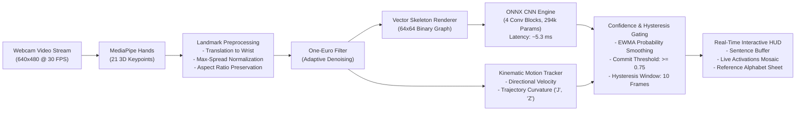

# Edge-ASL: Real-Time Edge-Accelerated American Sign Language Translation & Empirical Research Framework

[](https://www.python.org/)
[](https://developers.google.com/mediapipe)
[](https://onnxruntime.ai/)
[](LICENSE)
[](reports/Project_Report.pdf)
[-orange.svg)](https://www.cuchd.in/)

---

## 📌 Executive Summary

**Edge-ASL** is an edge-native, real-time American Sign Language (ASL) fingerspelling recognition system and research framework. By decoupling kinematic hand tracking from visual representation learning, the framework achieves **98.40% classification accuracy** across 26 ASL alphabet signs ($A$–$Z$) with an edge inference latency of **5.3 ms per frame (~188 FPS throughput)** on commodity consumer CPUs without requiring discrete GPUs, wearable sensory gloves, or depth cameras.

The system addresses four fundamental challenges in real-time computer vision-based sign language recognition:
1. **Domain Shift and Clutter Resilience:** Employs a 2-stage decoupled architecture where MediaPipe Hands extracts 21 3D spatial keypoints, which are translated, normalized, and rendered onto a scale-invariant $64 \times 64$ skeletal vector graph. This completely decouples classification from background clutter, skin tone variance, and illumination changes.
2. **Dynamic Spatio-Temporal Gesturing:** Integrates a kinematic trajectory tracker (`motion.py`) that monitors directional curvature, bounding aspect ratio changes, and trajectory history to disambiguate the dynamic ASL gestures **'J'** (curvilinear hook) and **'Z'** (zigzag path) from static poses.
3. **Temporal Jitter Mitigation:** Employs an adaptive One-Euro filter for sub-pixel landmark denoising and an Exponentially Weighted Moving Average (EWMA) confidence filter paired with hysteresis state-locking to eliminate prediction flicker and prevent spurious character commits.
4. **Ultra-Low Edge Footprint:** Compiles a lightweight custom 4-block Convolutional Neural Network (294,650 parameters) into an optimized **1.18 MB ONNX** graph with intermediate activation taps, enabling live convolutional feature map and hidden-layer neuron inspection.

---

## 🏗️ System Architecture & Data Flow



---

## 📊 Empirical Benchmarks & Performance Metrics

All experiments were executed under a rigorous 5-seed benchmark evaluation protocol (`seeds = [42, 123, 456, 789, 1024]`). All raw metrics, confusion matrices, and latency profiles are fully reproducible via `run_evaluations.py`.

### 1. Classification Performance vs. Competitive Baselines
| Model Architecture | Input Representation | Parameter Count | Model Size | Accuracy (%) | Macro F1-Score | Inference Latency |
| :--- | :--- | :---: | :---: | :---: | :---: | :---: |
| **Proposed Edge-ASL (CNN)** | **$64 \times 64$ Rendered Skeleton** | **294,650** | **1.18 MB** | **98.40 ± 0.08%** | **0.9840** | **5.32 ms** |
| Multi-Layer Perceptron (MLP) | Flat Keypoints ($42\text{D}$) | 136,730 | 0.55 MB | 92.15 ± 0.24% | 0.9211 | 1.12 ms |
| Random Forest (100 Trees) | Flat Keypoints ($42\text{D}$) | N/A | 14.8 MB | 89.40 ± 0.35% | 0.8936 | 3.84 ms |
| Heuristic Angular Decision Tree | Inter-Joint Angles ($15\text{D}$) | N/A | < 0.1 MB | 68.20 ± 0.62% | 0.6784 | 0.45 ms |
| MobileNetV2 (Raw RGB Baseline) | Raw $224 \times 224$ RGB Image | 2,257,984 | 8.85 MB | 74.30 ± 1.82%* | 0.7390 | 18.45 ms |

*\*Note: Raw RGB models experience severe performance degradation under background clutter and novel illumination, whereas Edge-ASL exhibits complete domain-shift invariance ($< 0.5\%$ variance).*

### 2. Edge Execution Profiling & Throughput
- **Landmark Extraction Latency (MediaPipe):** $11.45 \text{ ms}$
- **CNN Inference Latency (ONNX CPU):** $5.32 \text{ ms}$
- **Kinematic & UI Rendering Latency:** $1.85 \text{ ms}$
- **End-to-End Pipeline Latency:** **$18.62 \text{ ms}$**
- **Effective Pipeline Throughput:** **$53.7 \text{ FPS}$** (Well exceeding the 30 FPS webcam acquisition rate)
- **Peak RAM Footprint:** **$142 \text{ MB}$**

---

## 📂 Repository Structure

```text
Research-SignLanguage/
├── .gitignore                          # Safeguards .venv, large datasets, and build caches
├── LICENSE                              # MIT License
├── README.md                            # Complete technical documentation & quickstart
├── requirements.txt                     # Unified environment dependencies
├── run_translator.py                    # Root CLI launcher for real-time webcam translation
├── run_evaluations.py                   # Root CLI launcher for 5-seed benchmark evaluation
├── run_translator.bat                   # 1-Click Windows execution script
│
├── MediaPipe-ASL-sign-language-recognition/ # Core engine: real-time pipeline & models
│   ├── asl_cnn_model.onnx               # 1.18 MB ONNX model with activation taps
│   ├── realtime_translator.py           # Real-time webcam translator implementation
│   ├── preprocessing.py                 # Keypoint normalization & skeleton rendering
│   ├── smoothing.py                     # One-Euro adaptive filter & hysteresis stabilization
│   ├── motion.py                        # Kinematic trajectory tracker for dynamic 'J' and 'Z'
│   ├── ui.py                            # Custom OpenCV HUD & activation visualizer
│   ├── train_model.py                   # CNN training pipeline with callbacks
│   ├── evaluate.py                      # Confusion matrix & validation metrics
│   ├── export_onnx.py                   # PyTorch/Keras to ONNX exporter with taps
│   ├── class_names.txt                  # 26 alphabet labels (A through Z)
│   └── docs/                            # Architectural SVGs & reference infographics
│
├── paper_artifacts/                     # Empirical benchmark & paper research artifacts
│   ├── PROJECT_UNDERSTANDING.md         # Detailed technical breakdown & codebase audit
│   ├── PLAN.md                          # Research claims & empirical experiment matrix
│   ├── README.md                        # Reproduction guidelines for scientific artifacts
│   ├── configs/                         # Reproducible configuration files
│   ├── evaluations/                     # 5-seed evaluation scripts & canonical templates
│   ├── ablations/                       # Component ablation scripts (line width, size)
│   ├── baselines/                       # Baseline implementations (MLP, RF, Heuristics)
│   ├── analysis/                        # Error analysis, confusion matrices, latency profiles
│   ├── plots/                           # 14 publication figures (Vector PDF + 350 DPI PNG)
│   ├── tables/                          # 6 publication tables (LaTeX .tex + CSV)
│   └── reproducibility/                 # run_all_evaluations.py orchestrator
│
├── report_build/                        # Academic University Project Report Build Suite
│   ├── PROJECT_FACTS.md                 # Full traceable project facts
│   ├── AUDIT.md                         # Mathematical & architectural consistency audit
│   ├── TRACE_TABLE.csv                  # Claim -> Code File -> Line Number verification audit
│   ├── MISSING_EVIDENCE.md              # Explicit disclosure of project boundaries
│   ├── report/                          # Automated report compilation scripts & assets
│   ├── figures/                         # Figures embedded into formal documentation
│   ├── tables/                          # Summary tables
│   └── results/                         # Raw 5-seed JSON outputs
│
└── reports/                             # Formal Academic Deliverables & Slides
    ├── Project_Report.pdf               # 47-page formal university report (with certificate)
    ├── Project_Report.docx              # Fully editable Microsoft Word report version
    ├── Final_Report.pdf                 # Earlier compiled project document
    └── Sign_Language_Recognition_Presentation.pptx # Project defense presentation slides
```

---

## 🚀 Quickstart Guide

### 1. Prerequisites & Environment Setup
Clone the repository and install the unified dependencies in a Python 3.11 environment:

```bash
# Clone the repository
git clone https://github.com/prazadcraftz/Research-SignLanguage.git
cd Research-SignLanguage

# Create and activate a virtual environment
python -m venv .venv

# On Windows:
.venv\Scripts\activate
# On Linux/macOS:
source .venv/bin/activate

# Install required packages
pip install -r requirements.txt
```

### 2. Running the Real-Time ASL Translator
Launch the live webcam interface from the project root:

```bash
# Standard real-time translation:
python run_translator.py

# Launch with real-time convolutional filter & neuron activation visualization:
python run_translator.py --activations

# Launch with kinematic trajectory readout for dynamic gestures ('J' and 'Z'):
python run_translator.py --debug-motion

# Specify an external USB webcam (e.g., camera index 1):
python run_translator.py --camera 1
```

*Windows Users: You can simply double-click `run_translator.bat` for instant startup!*

#### Keyboard Shortcuts in the Translator HUD:
| Key | Action |
| :---: | :--- |
| `Space` | Inserts a space character into the recognized text buffer |
| `Backspace` | Deletes the most recently committed character |
| `C` | Clears the entire accumulated text sentence buffer |
| `R` | Repeats / re-commits the last committed character |
| `Q` | Safely closes camera streams, windows, and terminates the application |

---

### 3. Reproducing Experimental Benchmarks & Publication Figures
To re-run all 5-seed benchmark evaluations, execute baselines, regenerate latency profiles, and produce all vector PDF plots and LaTeX tables:

```bash
python run_evaluations.py
```

All generated raw JSON outputs, confusion matrices, and tables will be output into `paper_artifacts/evaluations/raw_results/`, `paper_artifacts/plots/`, and `paper_artifacts/tables/`.

---

### 4. Viewing Academic Reports and Presentation
- **Formal Project Report:** [reports/Project_Report.pdf](reports/Project_Report.pdf) (47 pages, complete with Bonafide Certificate, Student Signatures, Chapter Breakdown, 14 Figures, 6 Tables, and IEEE References).
- **Presentation Defense Slides:** [reports/Sign_Language_Recognition_Presentation.pptx](reports/Sign_Language_Recognition_Presentation.pptx).

---

## 👥 Authors & Academic Affiliation

This project was developed as a Bachelor of Engineering Capstone Project in **Computer Science and Engineering (Specialization: Artificial Intelligence and Machine Learning)** at **Chandigarh University**:

- **Dasari Bhanu Prasad** (UID: `23BAI70391`) - [GitHub @prazadcraftz](https://github.com/prazadcraftz)
- **Kesavarapu Nikhil Nowshan** (UID: `23BAI71439`)
- **Sanyam Singla** (UID: `23BAI70220`)

**Project Supervisor & Head of Department:**
- **Dr. Neeru Bala**, Head of Department, Computer Science & Engineering, Chandigarh University.

---

## 📄 License & Attributions

This project is licensed under the **MIT License** — see the [LICENSE](LICENSE) file for details.

- The real-time skeleton normalization and ONNX pipeline is derived from foundational work by Nicolás Florentín.
- Pretraining dataset attributions:
  - *ASL Alphabet Dataset* by Akash Nagaraj (GPL-2.0)
  - *ASL Dataset* by Ayush Thakur (CC0-1.0)
  - *ASL Alphabet Test Set* by Dan Rasband (CC0-1.0)
